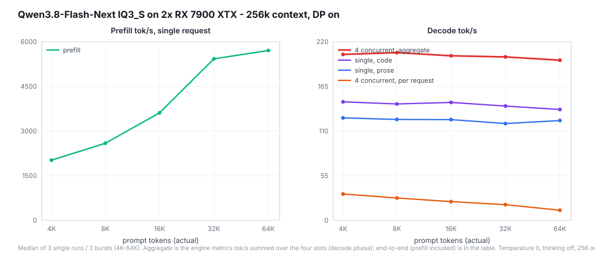

# Strata-RDNA3

RDNA3 (Radeon RX 7900 XTX, gfx1100) optimizations merged onto the current Strata engine, with
batch concurrency that raises aggregate throughput above a single stream.

This build runs Qwen3.8-Flash-Next IQ3_S with MTP speculative decoding, vision, a 256k context
and four concurrent request slots on two RX 7900 XTX cards.



## What this build adds

1. **The RDNA3 work, on current Strata code.** The gfx1100 optimizations from the Strata-rdna3
   fork (tensor-parallel and data-parallel prompt paths, fused int8 expert kernels, MMQ prompt
   tiles, hipBLASLt tuning tables, expert-cache policies, MTP slot drafters, wide verify windows
   of 9-16 rows) are merged into the current Strata engine source (0.1.59) instead of living in a
   fork that trails the engine. The tree builds, passes the engine's parity tests, and serves.

2. **Concurrency that pays.** Four batch slots plus the solo path for a lone request. A single
   request keeps MTP and decodes at 119-146 tok/s. Four concurrent requests decode at about
   **200 tok/s aggregate**, flat from 4K to 64K prompts, while each request still runs at
   12-33 tok/s. A request that arrives while another is running joins a batch slot instead of
   queueing behind it.

3. **Fast prompt reads with concurrency.** The data-parallel prompt path (both cards read the
   prompt on alternating chunks) normally requires a single-slot engine. Here it runs beside the
   batch slots for a lone request: 32K prompts prefill at about 5,200 tok/s (about 3,950 without
   it) while the four slots stay available for bursts.

## Measured (this build: upstream v0.2.22 merged, piped MTP drafts)

Two RX 7900 XTX, Qwen3.8-Flash-Next IQ3_S, with `strata-prod.json`
(`--batch-mtp`, `STRATA_PIPED_MTP=2`, `STRATA_BATCH_SELF_COMMIT=0`,
`STRATA_PREFILL_CPU_SHARE_MAX=8192`, `STRATA_PREFILL_LEND_PCT=93`, `--prefill 18432`).

### Single request: prefill (the prompt read)

| prompt | prefill tok/s |
|---:|---:|
| 4K | 1,550 |
| 8K | 2,628 |
| 16K | 3,299 |
| 32K | 4,198 |
| 64K | 4,787 - 4,971 |
| 128K | 5,683 - 5,792 |
| 256K | 5,613 - 5,715 |

Prefill rises with prompt length as the fixed costs amortize; 128K and up is at the
fork's ~5,700 tok/s.

### Four concurrent 8K prompts, 256 output tokens each

| metric | value |
|---|---|
| wall | 16.3 - 17.3 s |
| aggregate end-to-end | 58 - 63 tok/s |
| per-request decode | 26.5 - 29.3 tok/s |
| engine running=4 (the Monitor's number) | median 190 - 223, p90 247 - 294 |

The decode is at the 0.1.59 fork baseline on the median (193.8) and above it on p90 (209.1);
the prefill matches the fork from 128K. The earlier chart's 32K and 64K points (about 5,400
and 5,700) were its two-card DP; this build reads them on one card (the layer split), so
those two are lower here (4,181 and 4,914). The piped batch groups draft with the serial
path's synchronous MTP draft: 73% of the proposals are kept, 77 rows/s.

## Credits

This project is a merge, not a rewrite. It would not exist without:

- **[Strata](https://github.com/Niko1221/Strata)** by Niko1221 and contributors - the engine,
  its kernels, the batching and speculative-decoding design. MIT licensed.
- **[Strata-rdna3](https://github.com/nicejunjie/Strata-rdna3)** by nicejunjie and its
  contributors (cennac, Vop3p and others) - the gfx1100 tuning this build is based on:
  hipBLASLt tables, MMQ prompt tiles, the TP/DP prompt paths, expert-cache policies, the batch
  solo-path work and the wide-window kernels.
- **rocWMMA**, **ggml / llama.cpp** kernels, and **AMD ROCm** for the lower layers.

If you use this work, please credit Strata and the Strata-rdna3 fork first.

## Hardware and software

| | |
|---|---|
| GPUs | 2x AMD Radeon RX 7900 XTX 24 GB (gfx1100), PCIe 4.0 x8 each, no xGMI |
| CPU / RAM | Ryzen 9 9900X, 121 GB DDR5 |
| OS / ROCm | Ubuntu, kernel 7.0, ROCm SDK 10.3 (venv), in-kernel amdgpu |
| Engine | Strata 0.1.59 + the RDNA3 merge, HIP backend, gfx1100 |
| Model | DavidAU Qwen3.8-Flash-Next-Abliterated-Turbo-50x-Reasoning IQ3_S (GSQ-RCO), 84 GB with its 26.8 GiB PLE table |
| Context | 256k tokens (the model's native context), int8 KV, 32k KV resident |
| Concurrency | 4 batch slots (`--batch 4`), MTP (`--spec 4`), vision |

## Features

- Layer split across two cards (24/24 layers), with the DP prompt path for long prompts.
- MTP speculative decoding on the solo path; batch slots use the batch path.
- Four concurrent request slots. A lone request automatically uses the solo path; a newcomer
  stops it and it continues in a slot with its prefix reused.
- 256k native context (no YaRN needed), int8 KV cache, conversation cache (8 slots).
- Vision (image input) through a separate vision encoder.
- Fused int8 expert kernels, MMQ prompt tiles, hipBLASLt tuning for gfx1100.
- Wide verify windows (9-16 rows) for wide batch windows.

## Configuration

Key engine flags used in production:

```
--layer-split 24 --batch 4
--prefill 18432
--spec 4 --spec-min-p 0.5 --mtp /path/to/mtp/rt --mtp-q4 all --mtp-window 4096
--lookup-chain 3
--kv int8 --kv-resident 32768
--max-context 262144
--conversation-cache-mib 8192 --conversation-cache-slots 8
--expert-cache auto --ple-io direct --ple-row-cache 1048576
--pool-workers 8 --vram-reserve-mib 1024 --pcie-frac 0
--vision
```

Environment that matters on gfx1100:

```
STRATA_HIPBLASLT_TUNING=tools/hip/gfx1100-hipblaslt-100500.txt
STRATA_PREFILL_MMQ_TILE_ROWS=32
STRATA_PEER_TRANSPORT=host
GPU_MAX_HW_QUEUES=8
STRATA_REFILL_SDMA=0
HSA_USERPTR_FOR_PAGED_MEM=0
HSA_SVM_FOR_PAGED_MEM=0
STRATA_DP_PREFILL=1
STRATA_DP_EARLY_REFILL=0
```

`STRATA_DP_PREFILL=1` enables the two-card prompt path; the merge lets it run beside idle slots.
The HSA variables stop the kernel from reclaiming GPU-mapped expert memory (queue stalls and the
60 s watchdog on ROCm 10.2+).

Sampling: temperature 0, thinking off, `presence_penalty 0` (a nonzero penalty forces serial
decode and lowers MTP acceptance).

## Performance

Measured with `tools/bench.py`. Each prompt is a synthetic document of N tokens with three
5-character codes at the start, middle and end; the model must return the codes and then write an
English guide (`prose`) or a Python module (`code`). A run counts only when all three codes come
back with exactly 256 output tokens. The nominal targets are about 7% larger than the actual
prompt tokens after the tokenizer; the tables show the server's actual tokens.

### Single request

A lone request uses the solo path with MTP and the decode pipeline. Median of 3 runs.

| target | actual prompt | prefill tok/s | decode tok/s (prose) | decode tok/s (code) |
|---:|---:|---:|---:|---:|
| 4K | 3,852 | 2,020 | 126.1 | 145.9 |
| 8K | 7,638 | 2,588 | 124.2 | 143.3 |
| 16K | 15,210 | 3,609 | 124.0 | 145.2 |
| 32K | 30,356 | 5,425 | 119.2 | 140.7 |
| 64K | 60,642 | 5,704 | 122.9 | 136.5 |
| 128K | 121,218 | 5,700 | 118.3 | 139.6 |

Prefill rises with prompt length as fixed costs amortize, then flattens at about 5,700 tok/s
from 32K up. Decode is flat at 118-146 tok/s.

### Four concurrent requests

Four requests launched together, each with its own codes and nonce. `aggregate decode` is the
engine's own `tok_s` summed over the four slots during the decode phase (the concurrency number);
`aggregate end-to-end` is 4 x 256 output tokens divided by the wall time, prefill included;
`per-request decode` is the median of each request's decode rate. Median of 2 bursts.

| target | actual prompt | wall | aggregate decode tok/s | aggregate end-to-end tok/s | per-request decode tok/s |
|---:|---:|---:|---:|---:|---:|
| 4K | 3,853 | 12.9 s | **204.3** | 79.5 | 32.4 |
| 8K | 7,639 | 17.0 s | **206.5** | 60.3 | 27.5 |
| 16K | 15,211 | 22.3 s | **202.6** | 45.9 | 23.0 |
| 32K | 30,357 | 28.1 s | **201.2** | 36.4 | 19.3 |
| 64K | 60,643 | 49.4 s | **197.2** | 20.8 | 12.4 |

The aggregate decode throughput is about **200 tok/s at every length**: four slots decode
together at 1.4-1.7x a single stream (119-146 tok/s), and the sum does not fall as the context
grows. End-to-end throughput is lower only because the four prompt reads share the cards; that is
the prefill, not the decode. Per-request latency falls as the four slots share the two cards.

## Build

Requirements: ROCm SDK (HIP), CMake, Ninja, rocWMMA headers, and the model pack.

```sh
R=/path/to/rocm-sdk
export HIP_PLATFORM=amd HIP_COMPILER=clang HIP_RUNTIME=rocclr ROCM_PATH=$R HIP_PATH=$R
cmake -S . -B build -G Ninja -DCMAKE_BUILD_TYPE=Release \
  -DCMAKE_HIP_ARCHITECTURES=gfx1100 -DCMAKE_HIP_COMPILER=$R/llvm/bin/clang++ \
  -DSTRATA_ENABLE_HIP=ON \
  -DSTRATA_PREFILL_MMQ=ON -DSTRATA_MMQ_KQUANTS=ON \
  -DSTRATA_ROCWMMA_INCLUDE_DIR=/path/to/rocWMMA/library/include \
  -DCMAKE_PREFIX_PATH=$R
cmake --build build -j12
```

The engine binary is `build/strata`.

## Run

```sh
LD_LIBRARY_PATH=$R/lib ./build/strata --serve \
  --pack /path/to/pack --native /path/to/model-00001-of-00002.gguf \
  --ple-gguf /path/to/model-00002-of-00002.gguf \
  --mtp /path/to/mtp/rt --spec 4 \
  --layer-split 24 --batch 4 --prefill 18432 \
  --kv int8 --kv-resident 32768 --max-context 262144
```

Or through the Strata server, which adds the OpenAI-compatible API on port 1234:

```sh
python serve/server.py --engine strata --config strata.json --port 1234
```

## Repository layout

| Path | Contents |
|---|---|
| `src/core/` | verifier, prefill, MTP, expert sources, caches |
| `src/kernels/` | HIP/CUDA kernels (fused GR, router, MMQ, wide windows) |
| `src/program/` | `generate.cpp`, `verify.cpp`, server wiring |
| `src/prefill/` | prompt path, compatibility layer |
| `include/` | public headers |
| `rdna3/` | gfx1100 configs, tuning tables, MTP draft vocab, bench harness |
| `tools/` | `bench.py`, `monitor.py`, `iq_test.py` |
| `docs/media/` | benchmark chart |
| `BENCH.md` | full benchmark notes and methodology |

## License

MIT, following Strata. See [LICENSE](LICENSE). Strata is Copyright its authors; the RDNA3
optimizations are from the Strata-rdna3 fork and its contributors.
